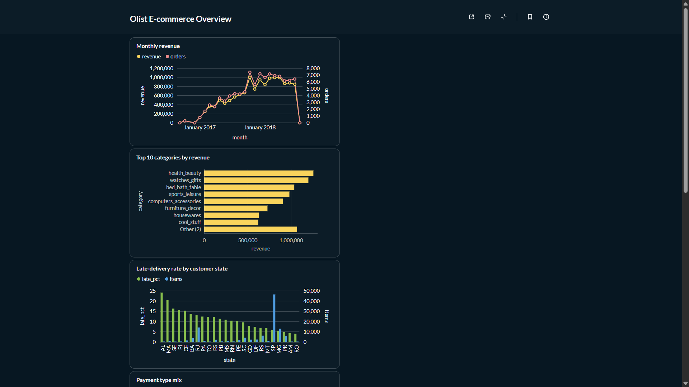
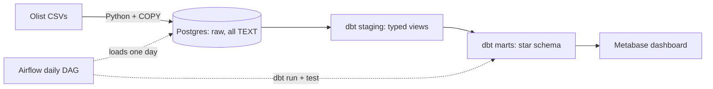
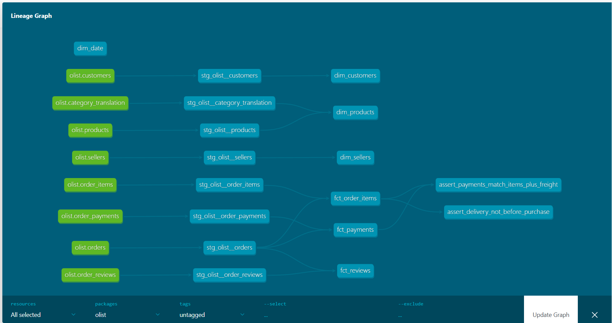
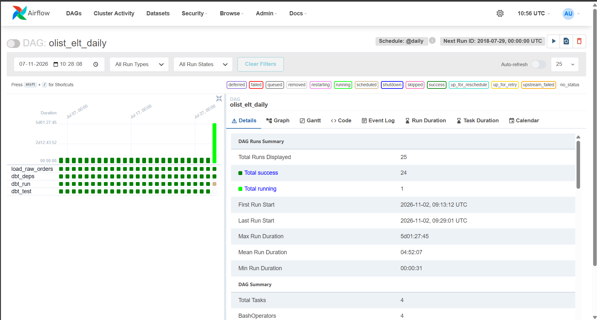

# Olist ELT Warehouse: Airflow + dbt + Postgres

A batch ELT pipeline for the [Olist Brazilian e-commerce dataset](https://www.kaggle.com/datasets/olistbr/brazilian-ecommerce). Raw CSVs are loaded into Postgres, modeled by dbt into a star schema (staging, then marts), tested, orchestrated by Airflow with simulated daily arrival, and explored in a Metabase dashboard.

**Stack:** Python, Airflow 2.10, dbt-core 1.8 (dbt-postgres), Postgres 16, Metabase, Docker Compose.



## Architecture



Airflow runs one DAG run per simulated day. Each run loads that day's orders into `raw`, then runs and tests the dbt project.



## Data model

| Layer | Objects | Notes |
|---|---|---|
| `raw` | customers, sellers, products, geolocation, category_translation, orders, order_items, order_payments, order_reviews | Faithful copy, every column TEXT, plus `_loaded_at` |
| `staging` | 8 views (`stg_olist__*`) | Typing, renaming, surrogate keys |
| `marts` | `fct_order_items`, `fct_payments`, `fct_reviews`; `dim_customers`, `dim_sellers`, `dim_products`, `dim_date` | Star schema; facts are incremental |

**Grains:** `fct_order_items` is one row per order item, `fct_payments` one row per payment on an order, `fct_reviews` one row per review. In Olist `customer_id` is per order and `customer_unique_id` identifies the person, so `dim_customers` carries both.

**Final row counts:** 112,650 order items, 103,886 payments, 99,224 reviews, 99,441 customers, 3,095 sellers, 32,951 products.

## Design decisions

- **Raw is a faithful copy.** All columns land as TEXT, so bad source values never break ingestion. Typing and cleaning happen in staging.
- **Simulated daily arrival.** Olist is a static export, so the loader releases one purchase date at a time (`load_olist.py day --date ...`). Re-running a date deletes and reloads that day's orders, so retries and backfills are safe.
- **Incremental facts.** The three fact models use dbt's `delete+insert` strategy on a surrogate key, filtered by an ingestion-time watermark (`_loaded_at`). The watermark filter uses `coalesce(max(_loaded_at), '1900-01-01')` because `max()` over an empty table is NULL, which would make the filter match nothing on a fresh build. This was found and fixed during testing.
- **dbt in its own virtualenv** inside the Airflow image, so dbt's dependencies never clash with Airflow's. `dbt-core` is pinned explicitly because an unpinned install pulled a pre-release that does not support Postgres.
- **Custom schema names.** A `generate_schema_name` override makes models land in `staging` and `marts` instead of `analytics_staging`.

## Testing and data quality

`dbt build` runs 66 nodes (8 staging views, 4 tables, 3 incremental models, 51 data tests): **65 pass, 1 warns, 0 errors.**

- Generic tests: `not_null`, `unique`, `accepted_values` (order status, payment type, review score 1 to 5) and `relationships` from every fact key to its dimension.
- `assert_delivery_not_before_purchase`: no item is delivered before it was purchased (passes with zero violations).
- `assert_payments_match_items_plus_freight`: per order, total paid should be within 1.00 of items plus freight. It is configured as a **warning** because small differences are expected. On the full dataset it flags 249 orders (about 0.25% of 99,441). In the July 2018 sample I inspected, the flagged orders were all overpaid credit-card orders split into 5 to 10 installments, consistent with installment interest.

### Incremental model validation

Two checks that the incremental model matches a full rebuild:

1. **Daily-replayed data (July 2018 sample):** 6,403 rows and 811,120.28 in item revenue, identical before and after `dbt run --full-refresh`.
2. **Full dataset:** 112,650 rows and 13,591,643.70 in item revenue, identical before and after `dbt run --full-refresh`. A second `dbt build` then added 0 rows (`INSERT 0 0`) to each incremental model.

## Insights from the dashboard

- Monthly revenue grew steadily through 2017 and then levelled off at roughly 1M per month in 2018. The drop at the right edge of the chart is the dataset ending, not a collapse.
- `health_beauty`, `watches_gifts` and `bed_bath_table` are the top revenue categories.
- Late-delivery rates vary widely by customer state, from about 24% in AL and above 20% in MA down to single digits in SP and the south.
- Orders delivered late average a review score of about 2.6, against about 4.3 for on-time orders.
- Credit card is the dominant payment type by value and count, followed by boleto.

## Orchestration



- `olist_bootstrap`: manual, loads the static dimension tables once.
- `olist_elt_daily`: `@daily`, `catchup=True`, `max_active_runs=1`. Tasks: `load_raw_orders` then `dbt_deps` then `dbt_run` then `dbt_test`, with 2 retries. The replay window starts at 2018-07-01.

## Run it yourself

Requirements: Docker Desktop, Python 3.9 to 3.12, and the Olist CSVs from Kaggle (login required) placed in `data/raw/olist/`.

**Fast path, dbt only (no Airflow):**

```bash
docker compose up -d warehouse
python -m venv .venv && source .venv/bin/activate      # Windows: .venv\Scripts\activate
pip install "dbt-core==1.8.8" "dbt-postgres==1.8.2" psycopg2-binary pandas
python ingestion/load_olist.py all                      # loads everything into raw
cd dbt && dbt deps && dbt build
```

**Full stack:**

```bash
# Linux only: echo "AIRFLOW_UID=$(id -u)" > .env
docker compose up -d --build
```

| Service | URL | Login |
|---|---|---|
| Airflow | http://localhost:8081 | admin / admin |
| Metabase | http://localhost:3000 | created on first visit |
| Postgres warehouse | localhost:5433, db `olist` | warehouse / warehouse |

In Airflow, trigger `olist_bootstrap` once, then unpause `olist_elt_daily`. In Metabase, add a PostgreSQL database with host `warehouse`, port `5432`, database `olist`, user and password `warehouse`.

Credentials above are local development defaults only.

## Limitations and next steps

- No SCD Type 2 dimension yet; a dbt snapshot on sellers or products is the planned addition.
- The `geolocation` table is loaded into `raw` but not modeled.
- Order status changes are not simulated, so late-arriving updates are only covered by the delete-and-reload behavior of the loader.
- Single-node Postgres and Airflow `LocalExecutor`; not sized for production.
- Planned: GitHub Actions running `dbt build` on pull requests, and a BigQuery or Snowflake adapter swap.